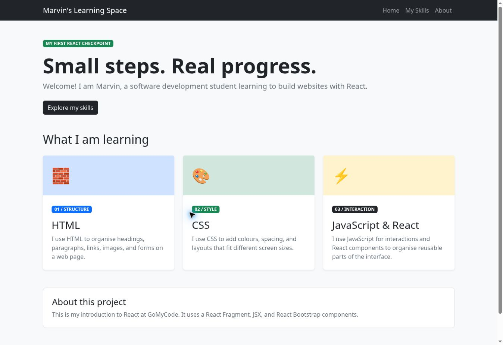

# First React Checkpoint

[Live demo](https://marvericklnk.github.io/react-first-checkpoint/)



A GoMyCode learning project built with React and React Bootstrap.

## Features

- A collapsible navigation bar.
- Three cards arranged in a responsive layout.
- An about section and footer.

## Run locally

Open the project folder in VS Code, then open **Terminal → New Terminal** and run:

```bash
npm install
npm start
```

Open the local address shown in the terminal. To create a production build, run `npm run build`.

## Built with

React · React Bootstrap · Create React App

---

A learning project by Marvin, with ChatGPT/Codex assistance.
